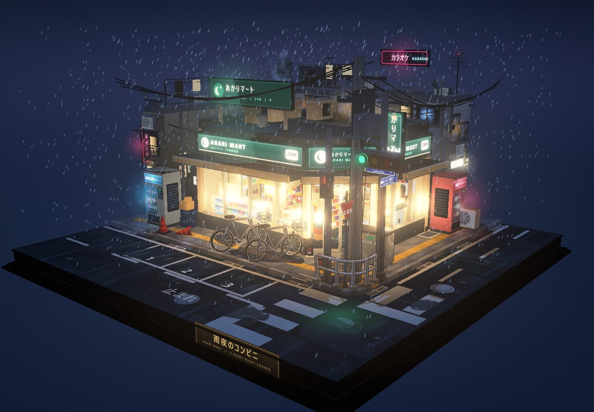
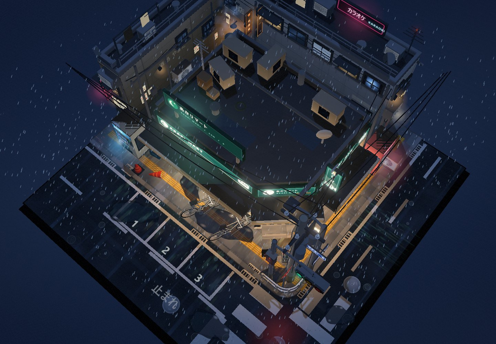

# 雨夜便利店测试记录，首轮对照与 DSH 独立复测

同一份雨夜便利店提示词，我先分别交给 DSH 和 Codex，记录两份成品、耗时和费用。之后又另开工作区，补做了一次 DSH 独立测试，原来的两份作品均保留。

> **首轮对照与独立复测说明**
> 首轮中，DSH 与 Codex 各只提交了一次相同的提示词，生成过程中没有补充提示、追加要求或人为修改、调整成品。后续新增的 DSH 第二次测试在全新工作区独立进行，不干扰或替换第一次结果。模型与代理自行调试和迭代属于各自任务过程。所有成品均保留，单次结果存在一定随机性，这些记录不代表重复测试时的稳定表现。

[打开全部测试作品](https://baihejiangnan.github.io/rainy-store-duo/)

## 测试环境

首轮对照中，两边使用的都是各自的官方客户端，以及测试时各自的最新版 harness。经补充确认，DSH 两次测试的客户端与内核版本、模型和推理档位完全相同，均为官方 DSH 客户端、DSH 0.2.1-rc2、DeepSeek-V4.1-Flash 1017 和 High 档位。第二次只另开了独立工作区，未更换这些配置。

| 项目 | DSH（两次相同） | Codex |
| --- | --- | --- |
| 桌面客户端 | 官方 DSH 客户端 | 官方 Codex 桌面端 |
| 内核 / harness 版本 | DSH 0.2.1-rc2 | 测试时最新版 |
| 模型 | DeepSeek-V4.1-Flash 1017 | GPT-6.1 Sol |
| 推理档位 | High | High |

DSH 的 Agent 预设使用标准模式。按本次测试记录，DSH 没有第三方插件参与任务，只开启了官方推荐的实验性功能和插件。DSH 的完成截图显示使用了 4 个子智能体，Codex 这次由主模型直接执行。两边的代理编排和工具环境有差异，所以这里比较的是各自实际跑出的结果。

## 产出形式与复现

两边收到的都只有文末这份原始提示词，没有额外要求仅制作单个 HTML 文件，也没有指定工程目录或交付格式。交付方式由各自的模型与代理自行决定。

DSH 生成了一个完整的项目文件夹，包含模块化场景源码、构建脚本、依赖锁文件、预览图、团队工作说明，以及可以直接打开的单文件 HTML 成品。

检查本地文件后，Codex 实际也生成了一个可重新构建的 Three.js 工程，包含场景源码、HTML 模板、构建脚本、依赖锁文件和本地预览服务。最初向用户交付的是自包含离线 HTML 与场景预览图。

两份工程已分别归档到比较仓库的 `projects/dsh/` 和 `projects/codex/`。本地依赖缓存、Git 元数据、发布平台配置和废弃中间构建没有入库。原始场景源码与成品未作修改。

新增的 DSH 第二次工程单独归档在 `projects/dsh-2/`，观看入口为 `dsh-2/`，第一次的目录和成品保持不变。第二次工程同样包含模块化源码、构建脚本、依赖锁文件和单文件 HTML，复现步骤见该目录 README。

[查看 DSH 完整项目](https://github.com/baihejiangnan/rainy-store-duo/tree/main/projects/dsh/) · [查看 Codex 完整项目](https://github.com/baihejiangnan/rainy-store-duo/tree/main/projects/codex/) · [下载整个仓库 ZIP](https://github.com/baihejiangnan/rainy-store-duo/archive/refs/heads/main.zip)

归档时使用 Node.js v24.19.0，在独立目录分别执行 `npm ci`，再运行各自的构建命令。DSH 使用 `node build.mjs --minify`，Codex 使用 `npm run build`。两份重新构建的 HTML 均与对应原始成品的 SHA-256 一致。具体步骤见各项目内的复现说明。

## 首轮成品感受

以下比较仅对应首轮两份成品，不适用于 DSH 第二次独立测试。

只看这次作品，我更喜欢 DeepSeek 做出来的细节。场景里的小物件、招牌和街角装饰更丰富，整体更耐看。

两份作品的色彩方向也不同。DeepSeek 的饱和度更高，冷暖对比更强；GPT 的颜色更收敛，整体饱和度较低。这部分属于设计取向，我不据此评高低。

让我觉得 GPT 处理得更好的，是换视角之后的降雨表现。

在 DeepSeek 的作品里，俯视和侧视时的雨丝形态差别不大。GPT 的雨丝会随着视角变化而缩短，俯视时更接近点，侧视时呈现细线。对一个可以自由旋转的三维模型来说，后者更符合我对雨滴运动投影的直觉。

核对源码后，这个差异也有了具体解释。DeepSeek 使用始终朝向相机的雨丝面片，雨丝长轴跟随屏幕方向，因此俯视时仍保留明显的线状外观。GPT 使用三维空间中的线段表示雨丝，投影长度会随观察角度变化。

就这两份作品而言，我更喜欢 DeepSeek 的细节丰富度和观赏性，GPT 的降雨在换视角时表现得更合理。这些都是针对本次成品的个人感受。

## DSH 第二次独立测试

我对 DSH 第一次的实际结果不满意，与我看到的网上评价有落差，于是新开了一个工作区，重新做了一次独立测试，没有干扰原有项目。这次耗时约 1 小时 30 分钟。第二次成品与第一次、Codex 的成品一起展示，方便直接比较。

第二次使用的客户端、内核版本、模型和 High 档位均与第一次相同，即官方 DSH 客户端、DSH 0.2.1-rc2、DeepSeek-V4.1-Flash 1017、High。

[打开 DSH 第二次测试](https://baihejiangnan.github.io/rainy-store-duo/dsh-2/) · [查看第二次完整项目](https://github.com/baihejiangnan/rainy-store-duo/tree/main/projects/dsh-2/)

DSH 第二次独立测试。截图来自原始单文件成品，场景未作修改。

> **复看更正**
> 此前我认为第二次也出现了与第一次相同的雨效问题，是我看错了。重新查看后，第二次并没有出现此前所说的雨效问题，整体表现也明显好于第一次。这里撤回原来的判断，并更新记录。

同样的客户端、模型和 High 档位，两次独立测试的结果却有明显差异。这也提醒我，单次结果存在随机性，不能用第一次的表现概括后续结果。

第二次原始成品的高角度截图，仅供查看场景。

## 交付方式与耗时的看法

两次 DSH 都给出了模块化的完整项目。这种交付方式可能是耗时较长的原因之一，但我没有单独测量工程组织、建模和调试各自花了多久，不能把全部耗时归到模块化上。

两边的提示词都没有约束必须采用什么工程结构，也没有要求只制作单个 HTML。两次 DSH 选择生成模块化完整项目，都是它自己决定的。Codex 也生成了可重新构建的工程，并交付了单文件成品。

在这次测试里，理解任务、选择适当的完成方式，也是我想观察的一部分。是否采用模块化工程、花多少时间组织和调试，都属于实际交付过程。我认为将这些自主选择带来的结果和耗时一并记录是合理的，不能仅因为 DSH 自行选择了完整工程，就认定这次对照不公平。

## 耗时与费用

| 项目 | DSH 第一次 | Codex 首轮 |
| --- | --- | --- |
| 单次任务耗时 | 约 2 小时 15 分钟 | 12 分 16 秒 |
| 费用记录 | 界面显示 ¥3.1073 | 使用 ChatGPT Plus 套餐额度 |

DSH 第一次的耗时和费用取自图 1 的完成记录。原界面显示 2 小时 15 分 30 秒，展示时统一记为约 2 小时 15 分钟，与第二次测试的耗时分别记录。

DSH 第二次独立测试耗时约 1 小时 30 分钟，来自本次补充记录。第二次费用及更精确的起止时间尚未提供，不沿用第一次的 ¥3.1073。

Codex 在本地场景完成后，又自行进入了部署和发布流程。我中途叫停，因此界面没有直接给出完整任务的耗时。后来单独追问，按会话开始和交付时间核对，得到 12 分 16 秒，包含制作、调试、检查、打包，以及叫停前的发布尝试。图 2 记录了这次追问。这里的时间不包含之后另行要求的 GitHub Pages 部署。

Codex 的费用只能按任务前后的额度记录估算。本次记录到的变化是，5 小时额度已用比例从 44% 上升到 60%，增加 16 个百分点；每周额度已用比例从 7% 上升到 9%，增加 2 个百分点。这些是套餐使用额度的变化，不能直接与 ¥3.1073 做金额比较，也不能据此准确算出本次任务的人民币成本。

图 1。DSH 第一次完成界面的原始记录，显示耗时 2 小时 15 分 30 秒，展示时记为约 2 小时 15 分钟；费用 ¥3.1073，模型为 DeepSeek-V4.1-Flash 1017，High 档位。

图 2。Codex 的任务耗时经追问核对为 12 分 16 秒，模型为 GPT-6.1 Sol，High 档位。

## 完整提示词

请制作一个雨夜便利店街角小场景，不准使用blender，以第三视角观察整个场景，整体像一个可以自由拖拽、旋转、缩放观看的微缩三维模型 / 小型景观，没有任何UI界面元素。地面为一个完整的正方形底座，所有元素都搭建在这个底座上，构图紧凑、层次清晰，整体呈现出小巧、精致、可收藏的模型感。画面风格为三渲二，强调浓厚的日式二次元动画氛围，材质表现干净，轮廓明确，色彩柔和但富有夜景霓虹的层次感。场景主体是一处日式便利店街角，便利店位于底座的视觉中心，外部有典型的日式街角元素：便利店招牌、玻璃橱窗、自动门、屋檐雨棚、门口地垫、自动贩卖机、自行车、雨伞架、垃圾桶、路灯、电线杆、电线、路牌、街角护栏、停车位、排水沟、积水路面、反光斑马线、小巷入口、空调外机、小型公告栏或海报栏等。街道不需要太大，但要有明确的街角转折感，像日本动画里常见的夜晚社区一角。不要人物，但便利店内部一定要有足够内容，并且可以透过大面积玻璃窗清楚看到店内。店内可见典型便利店陈设，例如：整齐排列的货架、饮料柜、便当区、饭团和零食陈列、收银台、咖啡机、杂志架、宣传海报、店内灯箱、冰柜、关东煮柜台、地面导视、储物柜或后场门等。要让便利店内部显得明亮、温暖、真实、充实，与室外潮湿昏暗的雨夜形成鲜明对比，营造出非常典型的日式动画雨夜氛围。美术风格重点强调：高精细建模、三渲二卡通渲染、清晰的轮廓线、细腻但简洁的材质层次、湿润的夜景反光、暖色室内灯光与冷色雨夜街景对比、浓厚的二次元日常场景感。整体气质应偏向安静、治愈、带一点都市夜晚孤独感但依然温暖，像一幕被定格下来的日本动画街角场景模型。加入一些基础动效来增强生命力：持续降雨、屋檐滴水、地面积水波纹、便利店招牌或灯箱轻微闪烁、自动门偶尔开合、雨水沿玻璃滑落、街道路面积水反射灯光、远处交通信号灯微弱变化等。整体效果应像一个静止而精致的三维微缩世界，但带有恰到好处的细微动态，突出其三渲二、二次元、雨夜、便利店、街角、小巧精致的核心特征。
