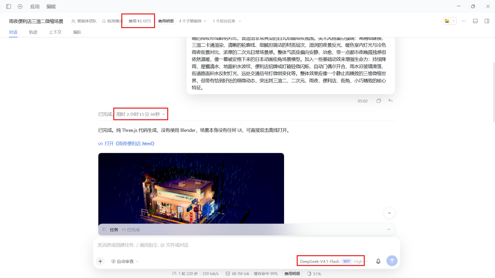

# 同一份雨夜便利店提示词，DeepSeek 与 GPT 各做了一份

同一份雨夜便利店提示词，我分别交给了 DSH 和 Codex。两边各跑一次，再看成品、耗时和费用记录。这是一份个人体验记录，样本只有一次。

[打开两份作品](https://baihejiangnan.github.io/rainy-store-duo/)

## 测试环境

两边使用的都是测试时各自的最新版 harness，具体配置如下。

| 项目 | DSH | Codex |
| --- | --- | --- |
| 桌面端 / harness | DSH 0.2.1-rc2 | 官方 Codex 桌面端 |
| 模型 | DeepSeek-V4.1-Flash 1017 | GPT-6.1 Sol |
| 推理档位 | High | High |

Agent 预设使用标准模式。按本次测试记录，没有第三方插件参与任务，Codex 只开启了官方推荐的实验性功能和插件。DSH 的完成截图显示使用了 4 个子智能体，Codex 这次由主模型直接执行。两边的代理编排和工具环境有差异，所以这里比较的是各自实际跑出的结果。

## 成品感受

只看这次作品，我更喜欢 DeepSeek 做出来的细节。场景里的小物件、招牌和街角装饰更丰富，整体更耐看。

两份作品的色彩方向也不同。DeepSeek 的饱和度更高，冷暖对比更强；GPT 的颜色更收敛，整体饱和度较低。这部分属于设计取向，我不据此评高低。

让我觉得 GPT 处理得更好的，是换视角之后的降雨表现。

在 DeepSeek 的作品里，俯视和侧视时的雨丝形态差别不大。GPT 的雨丝会随着视角变化而缩短，俯视时更接近点，侧视时呈现细线。对一个可以自由旋转的三维模型来说，后者更符合我对雨滴运动投影的直觉。

核对源码后，这个差异也有了具体解释。DeepSeek 使用始终朝向相机的雨丝面片，雨丝长轴跟随屏幕方向，因此俯视时仍保留明显的线状外观。GPT 使用三维空间中的线段表示雨丝，投影长度会随观察角度变化。DeepSeek 的做法称为面向相机的雨丝面片更准确，直接说成贴图容易让人误以为整个降雨只是一张覆盖画面的图片。两者都属于实时图形中的雨效近似。

就这两份作品而言，我更喜欢 DeepSeek 的细节丰富度和观赏性，GPT 的降雨在换视角时表现得更合理。这些都是针对本次成品的个人感受。

## 耗时与费用

| 项目 | DSH / DeepSeek | Codex / GPT |
| --- | --- | --- |
| 单次任务耗时 | 2 小时 15 分 30 秒 | 12 分 16 秒 |
| 费用记录 | 界面显示 ¥3.1073 | 使用 ChatGPT Plus 套餐额度 |

DSH 的耗时和费用取自图 1 的完成记录。

Codex 在本地场景完成后，又自行进入了部署和发布流程。我中途叫停，因此界面没有直接给出完整任务的耗时。后来单独追问，按会话开始和交付时间核对，得到 12 分 16 秒，包含制作、调试、检查、打包，以及叫停前的发布尝试。图 2 记录了这次追问。这里的时间不包含之后另行要求的 GitHub Pages 部署。

Codex 的费用只能按任务前后的额度记录估算。本次记录到的变化是，5 小时额度已用比例从 44% 上升到 60%，增加 16 个百分点；每周额度已用比例从 7% 上升到 9%，增加 2 个百分点。这些是套餐使用额度的变化，不能直接与 ¥3.1073 做金额比较，也不能据此准确算出本次任务的人民币成本。

图 1。DSH 完成界面显示，耗时 2 小时 15 分 30 秒，费用 ¥3.1073，模型为 DeepSeek-V4.1-Flash 1017，High 档位。

图 2。Codex 的任务耗时经追问核对为 12 分 16 秒，模型为 GPT-6.1 Sol，High 档位。

## 完整提示词

请制作一个雨夜便利店街角小场景，不准使用blender，以第三视角观察整个场景，整体像一个可以自由拖拽、旋转、缩放观看的微缩三维模型 / 小型景观，没有任何UI界面元素。地面为一个完整的正方形底座，所有元素都搭建在这个底座上，构图紧凑、层次清晰，整体呈现出小巧、精致、可收藏的模型感。画面风格为三渲二，强调浓厚的日式二次元动画氛围，材质表现干净，轮廓明确，色彩柔和但富有夜景霓虹的层次感。场景主体是一处日式便利店街角，便利店位于底座的视觉中心，外部有典型的日式街角元素：便利店招牌、玻璃橱窗、自动门、屋檐雨棚、门口地垫、自动贩卖机、自行车、雨伞架、垃圾桶、路灯、电线杆、电线、路牌、街角护栏、停车位、排水沟、积水路面、反光斑马线、小巷入口、空调外机、小型公告栏或海报栏等。街道不需要太大，但要有明确的街角转折感，像日本动画里常见的夜晚社区一角。不要人物，但便利店内部一定要有足够内容，并且可以透过大面积玻璃窗清楚看到店内。店内可见典型便利店陈设，例如：整齐排列的货架、饮料柜、便当区、饭团和零食陈列、收银台、咖啡机、杂志架、宣传海报、店内灯箱、冰柜、关东煮柜台、地面导视、储物柜或后场门等。要让便利店内部显得明亮、温暖、真实、充实，与室外潮湿昏暗的雨夜形成鲜明对比，营造出非常典型的日式动画雨夜氛围。美术风格重点强调：高精细建模、三渲二卡通渲染、清晰的轮廓线、细腻但简洁的材质层次、湿润的夜景反光、暖色室内灯光与冷色雨夜街景对比、浓厚的二次元日常场景感。整体气质应偏向安静、治愈、带一点都市夜晚孤独感但依然温暖，像一幕被定格下来的日本动画街角场景模型。加入一些基础动效来增强生命力：持续降雨、屋檐滴水、地面积水波纹、便利店招牌或灯箱轻微闪烁、自动门偶尔开合、雨水沿玻璃滑落、街道路面积水反射灯光、远处交通信号灯微弱变化等。整体效果应像一个静止而精致的三维微缩世界，但带有恰到好处的细微动态，突出其三渲二、二次元、雨夜、便利店、街角、小巧精致的核心特征。
